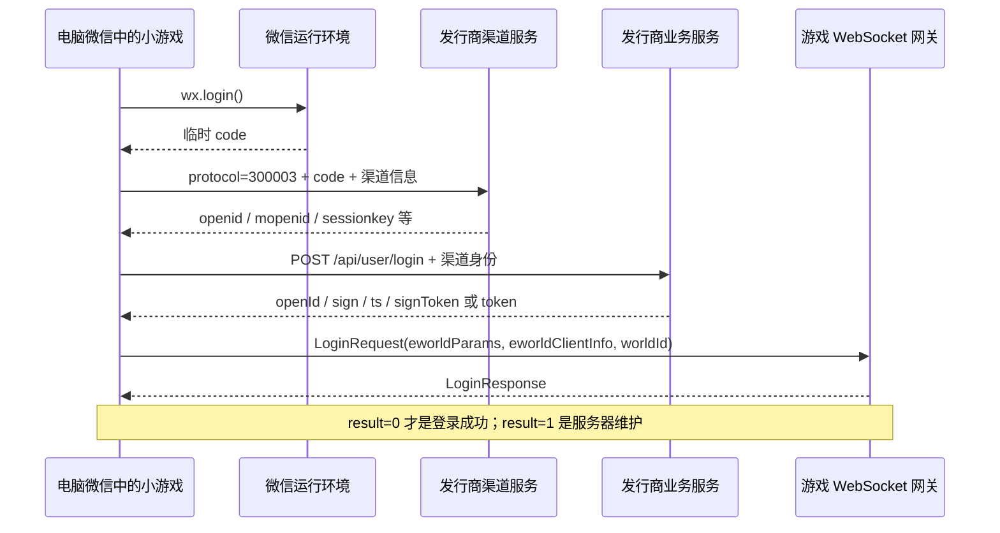

# 微信版登录链分析

分析日期：2026-10-19。对象是本机微信缓存中的《疯狂水世界》，AppID `wx2ea52a972ea18e5e`，缓存版本目录 `71`。
7 个 `wxapkg` 已解密并展开为 42 个文件。本次结论来自静态源码与离线测试，未进行真实账号登录验证。

## 结论

这个版本走 **微信运行环境取得临时 code → 发行商渠道认证 → 发行商业务认证 → 游戏网关登录**。
SDK 最终返回协议工具需要的 `openId、token、timestamp、sign`，不能把微信临时 code 直接填成游戏 token。

补充：用户提供的 `xyzw_web_helper` 确有“手机微信扫码 → 原生 App OAuth → 发行商 → 游戏凭证”实现。
小游戏包内没有扫码入口不能否定这类跨端方案；能否移植还取决于《疯狂水世界》的原生认证与账号映射。
源码对照及官方其他入口见 [扫码登录进一步分析](wechat-qr-comparison.md)。

在已分析的实际登录链中，没有发现二维码授权会话创建、扫码确认、票据轮询或票据兑换接口。
SDK 内的二维码主要用于支付；游戏业务代码另有公众号、社群和客服入口码。
这只说明该版本客户端没有提供现成的独立扫码登录流程，不能据此证明发行商服务端绝不存在其他接口。

原工具的“扫码添加”将一个自行拼接的游戏启动链接画成二维码，没有会话标识或授权回调。
页面轮询的是本机采集器状态。手机扫码打开游戏，不能把手机流量或凭证传到电脑的 `127.0.0.1` 代理。
界面现改为“从电脑微信添加”，移除未经验证的自动生成启动码；用户提供的 `data/qrcode.png` 仅作为入口展示。

## 实际调用链



渠道请求的默认地址是 `https://minigame.ewan.cn/minigame`，备用地址为 `https://minigame-channel.cwmob.cn/minigame`。
业务登录默认地址是 `https://api.gzxianc.com/api/user/login`，备用主机为 `api.gzxiancheng.com`。
这些是包内默认配置，SDK 支持配置域名切换，未通过真实流量确认当前使用的主机。
游戏正式网关在 `GameManager.loginSDK` 中设置为 `wss://dhyaoj-gate.khlgamen.com/ws`。

业务登录返回值的字段映射：

| `LoginRequest.eworldParams` | 业务登录响应 `m` |
|---|---|
| `openId` | `m.openId` |
| `token` | `m.signToken || m.token` |
| `timestamp` | `m.ts.toString()` |
| `sign` | `m.sign` |

业务 HTTP 请求自身的签名与游戏凭证的 `sign` 是不同层次；后者来自登录响应。
`eworldClientInfo` 还包含发行商 appId、channelId、客户端版本、平台等；这些字段应随真实登录请求一起保存。

## 源码定位

下表的字符偏移是将整个物理文件作为 UTF-8 文本读取后，JavaScript 的 0 起始 UTF-16 索引，部分为附近位置。
文件保留原始压缩格式，所以同一行可能很长；可用 `node tools/ctx.mjs <文件> <关键字>` 查看局部。

| 解包文件（相对仓库根目录） | 行／字符偏移 | 关键行为 |
|---|---:|---|
| `work/extracted/__APP__/game.js` | 1221／2722660 | `sdkLoadFunc` 加载 `minisdk`，将 `wxMiniSuperSDK.js` 默认导出设为 `globalThis.wxEwSDK` |
| `work/extracted/_subpackages_main_/subpackages/main/game.js` | 357／779014 | 微信平台选择 `ESDKType.WxEWan` |
| 同上 | 2607／5422722 | `SDKManager` 构造 `WxEWanSDK`，转发登录调用 |
| 同上 | 3475／7243512 | `_wxSDK.login({onSuccess,onFailed})` |
| 同上 | 3475／7246967 | SDK 成功回调进入 `GameManager.instance.loginSDK(e)` |
| `work/extracted/_subpackages_minisdk_/subpackages/minisdk/game.js` | 11／379790 | `toLogin → wx.login`；成功后发送 `code` 至渠道登录接口 |
| 同上 | 11／371553 | 渠道登录协议号 `300003` |
| 同上 | 11／337293 | `setLoginData` 整理渠道身份；`sessionkey` 属于渠道层 |
| 同上 | 11／415631 | 从 `EWORLAD_TOKEN` 读取旧业务 token，调用业务登录 |
| 同上 | 11／416219 | 将业务响应映射为 `openId/sign/timestamp/token` |
| 同上 | 11／417407 | `ownUserData` 缓存最终回调对象 |
| `work/extracted/_subpackages_main_/subpackages/main/game.js` | 1333／2863025 | `loginSDK` 连接网关并构造 `LoginRequest` |
| 同上 | 1849／3938320 | `LoginProxy.logined` 以 `LoginResult.LOGIN_SUCCESS` 判断成功 |
| `work/extracted/_src_chunks_/src/chunks/game.js` | 3／982924 | 枚举确认 `LOGIN_SUCCESS=0`、`SERVER_MAINTAIN=1` |
| 同上 | 3／133396 | 网络层 `checkAuthResult` 比较上述成功枚举 |

`EWORLAD_TOKEN` 的拼写来自原包。SDK 将响应 `m.token` 写回该键，最终游戏 token 则优先用 `m.signToken`，两者不应混用。
缓存存在不代表凭证仍有效。本次未读取个人账号的缓存值。
没有在这条登录链发现独立的刷新 token 接口；支付错误 `22002` 会触发完整 `reLogin`。
网关返回 `LOGIN_UNKNOWN_ERROR` 且错误消息为 `invalid_grant` 时，游戏派发 `ON_INVALID_TOKEN`。

## 对工具的影响

本仓库当前已实现的采集流程是：在已经登录目标微信账号的电脑版微信中启动游戏，让真实微信环境完成上述认证，采集最终 `LoginRequest`。
若要访问手机已有角色，电脑需要使用同一个微信账号和同一游戏渠道；再核对区服与角色。
电脑版微信自己的扫码登录仍由微信提供，协议工具没有因此获得独立的微信扫码授权能力。

“捕获并保存请求”与“游戏接受登录”是两个状态。后者必须得到 `LoginResponse.result === 0`。
控制台保存后会尝试连接读取角色；若验证失败，凭证记录仍保留并在日志说明。该尝试可能使已有游戏会话掉线。

本次修复了网页与 CLI 采集流程的首次使用及清理问题：无证书时可查询状态；监听成功后才改系统代理；
保存修改前的代理快照；保留原先已安装的 CA；成功、失败、取消及超时后清理本次改动。
采集仅解密明确的游戏网关，其他 CONNECT 流量原样转发。CLI 成功写入时才替换旧凭证。

协议定义已恢复至工具默认读取路径 `work/extracted/_src_chunks_/src/chunks/game.js`。
解包内容、原包与个人凭证均位于 Git 忽略目录，不随源代码提交。

## 复现与验证

单个包的解密与解包命令如下；输出必须是新路径，工具会拒绝覆盖现有文件：

```powershell
node tools/wxapkg.mjs decrypt wx2ea52a972ea18e5e <原始包路径> <解密输出.wxapkg>
node tools/wxapkg.mjs unpack <解密输出.wxapkg> <解包输出目录>
npm run test:wxapkg
npm run test:wechat
npm test
```

原始 `_src_chunks_.wxapkg` SHA-256：`7A3D68F5D0C278BEE26D8323CFDD261D072A55D5ED926A49F61ACEC47910E2F8`。
原始 `_subpackages_minisdk_.wxapkg` SHA-256：`C1BD1E5DAB14BB527213CE485BFB022A8F3C3211EB5F5DAEC70E8E8784F93631`。

离线测试只验证格式、模拟采集与回滚，不证明真实微信客户端走系统代理，也不证明游戏接受复用凭证。
真实验证仍需在电脑微信中打开游戏，观察捕获结果和服务器返回。

## 微信官方接口背景

- [`wx.login`](https://developers.weixin.qq.com/minigame/dev/api/open-api/login/wx.login.html)：在微信小游戏环境取得临时 code，文档注明有效期 5 分钟并支持 Windows/Mac。
- [`code2Session`](https://developers.weixin.qq.com/minigame/dev/api-backend/open-api/login/auth.code2Session.html)：对应小游戏服务端用 appId、appSecret 和 code 换取微信身份；它不直接签发本游戏的业务 token。
- [网站应用微信登录](https://developers.weixin.qq.com/doc/oplatform/Website_App/WeChat_Login/Wechat_Login.html)：属于网站应用的 OAuth 扫码流程，不能用普通小游戏 AppID 替代网站应用配置来换取本游戏凭证。
